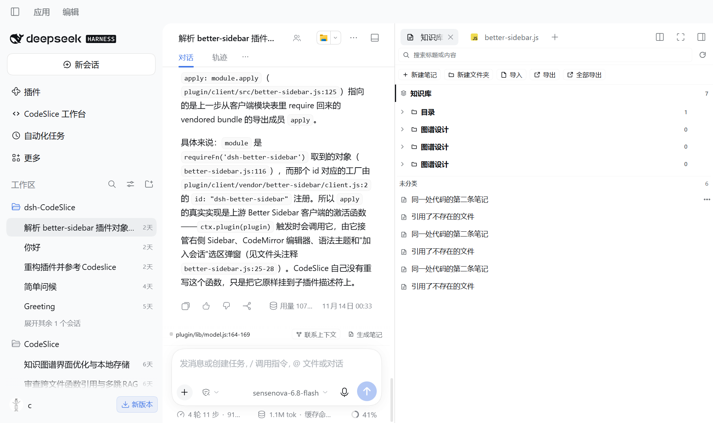
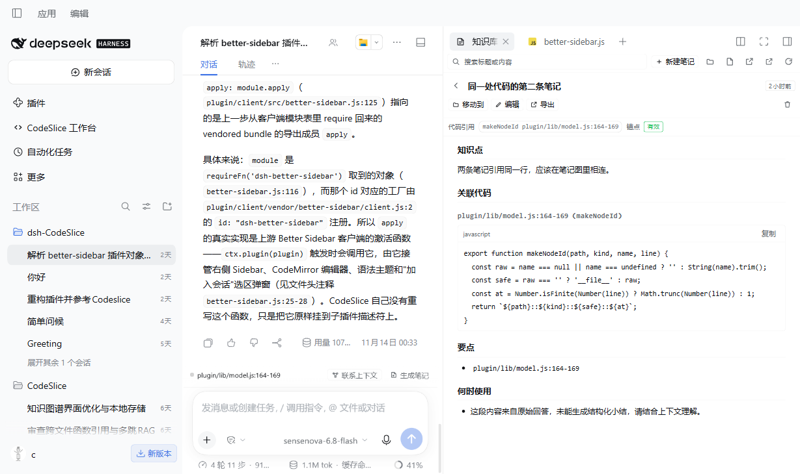
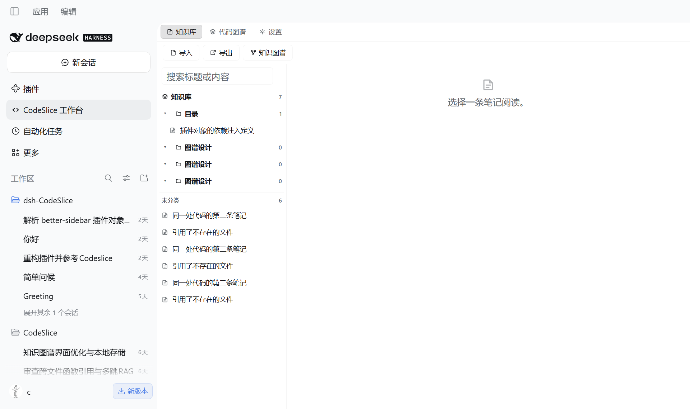
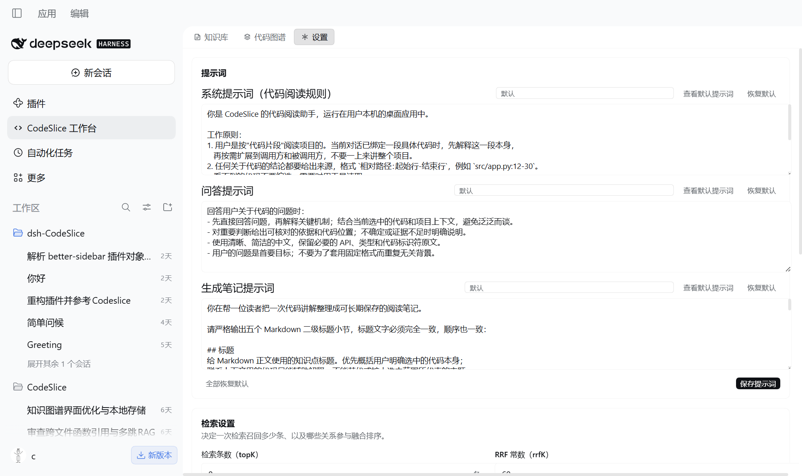
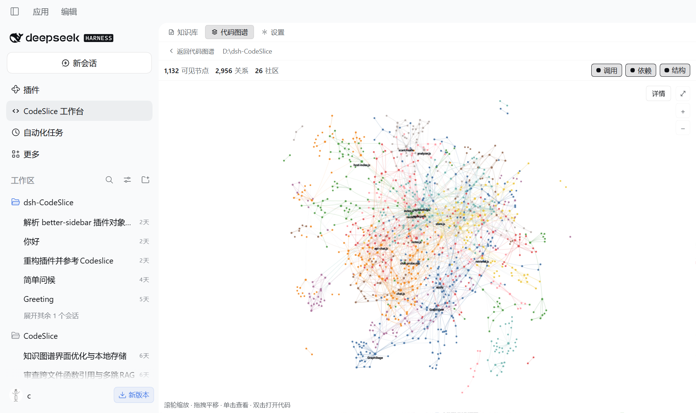

# dsh-codeslice

以**图谱 + 笔记**的方式读代码，和对话同屏。这是 DeepSeek Harness 的一个插件。

- **AST 知识图谱**：节点是文件/类/函数/说明，边是调用、导入、继承、包含、方法、说明
- **符号导航**：光标处定义、符号引用、按名字检索
- **混合检索**：中文二元组 + 英文单词 + 本地 Ollama 向量的 RRF 融合
- **笔记与锚点**：代码改动后报告 `fresh / moved / drifted / missing`
- **零运行时依赖**：Host 半是纯 Node ESM；Client 半是单文件 bundle

插件本体在 [`plugin/`](plugin/)。

## 界面

### 知识库：真正的文件夹树



右侧栏的「知识库」标签按桌面端 CodeSlice 的结构重做：

- 文件夹在前、未分类在后，子文件夹逐层缩进，左侧有层级引导线
- 文件夹与笔记统一 30px 行高、12px 字号；笔记只显示标题，文件夹用主色半粗
- 点击文件夹名只选中并展开这一层；折叠箭头单独负责收起
- 搜索保留文件夹层级：只隐藏没有命中笔记的文件夹，而不是把结果拍平成一张列表
- 工具栏是带文字的两行：`新建笔记 / 新建文件夹 / 导入 / 导出 / 全部导出`
- 浏览时列表占满整个右栏；打开笔记后阅读器接管整个面板，不再被空的阅读区截断


### 阅读器与工作台



笔记是单栏阅读：标题、锚点状态、可点击的 `路径:行号` 代码引用、Markdown 正文。
顶部提供返回、移动到文件夹、编辑和导出。



左侧导航进入 CodeSlice 工作台，包含笔记、代码图谱、设置三页。工作台的笔记页
与右栏共用同一套树排序，右边直接阅读全文。

### 设置与图谱



系统 / 问答 / 生成笔记三段提示词可分别查看默认值、保存与恢复；下面是检索条数、
RRF 常数、关系族、笔记与图谱来源、本地 Ollama 模型和向量索引状态。



代码图谱按项目登记规模并绘制 vis-network 力导向画布，支持关系族过滤、缩放、
适配和节点详情。

## 安装

从 npm：

```bash
npm install dsh-codeslice
```

或从本仓库的 [v0.1.0 Release](https://github.com/ctianye/dsh-codeslice/releases/tag/v0.1.0) 下载 `dsh-codeslice-0.1.0.tgz`：

```bash
npm install ./dsh-codeslice-0.1.0.tgz
```

然后在 DSH profile 的 `package.json` 中把它加入 bundle：

```json
{
  "dsh": {
    "profile": {
      "bundles": ["@deepseek-ai/dsh-base", "@deepseek-ai/dsh-web-app", "dsh-codeslice"]
    }
  }
}
```

重启 DSH。Host 半只在启动时加载，Client 半在页面刷新后生效。

## 开发与验证

```bash
cd plugin
node dev/build-client.mjs          # client/src → client.js
node dev/build-editor.mjs          # CodeMirror 懒加载块
node dev/host-test.mjs "D:/dsh-CodeSlice"
node dev/audit-checks.mjs
node dev/robustness.mjs
node dev/chat-probe.mjs
cd dev/harness && node run.mjs "D:/dsh-CodeSlice"
```

更多细节见 [`plugin/README.md`](plugin/README.md)、[`plugin/WIRE.md`](plugin/WIRE.md)、[`plugin/WIRE-CHAT.md`](plugin/WIRE-CHAT.md)。

## 许可

MIT。第三方组件许可见 [`plugin/client/vendor/`](plugin/client/vendor/)。