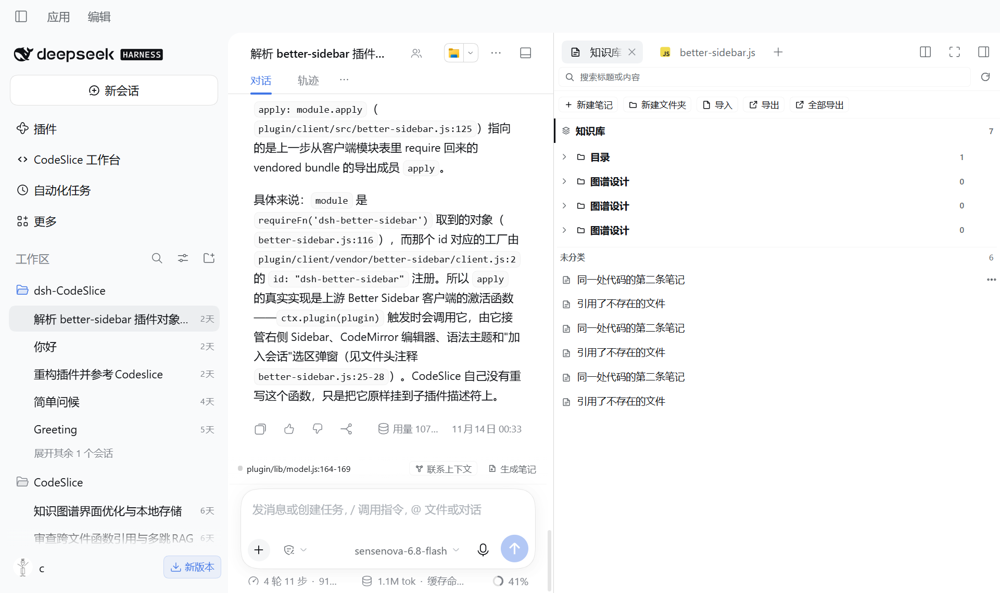
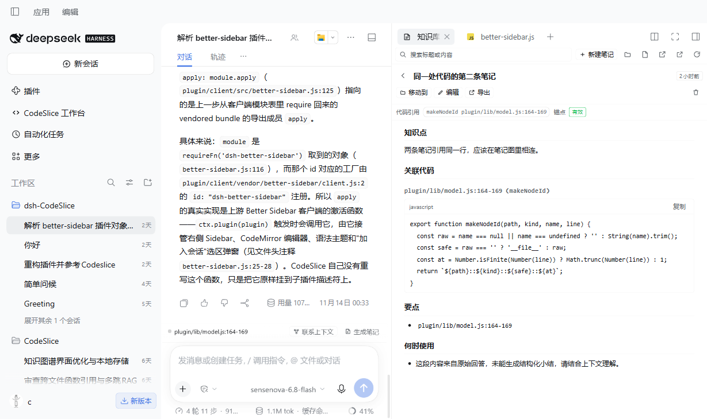
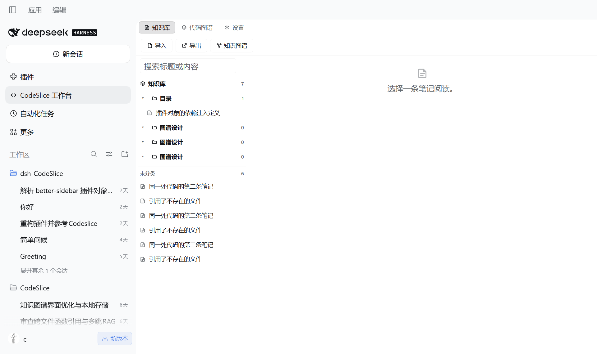
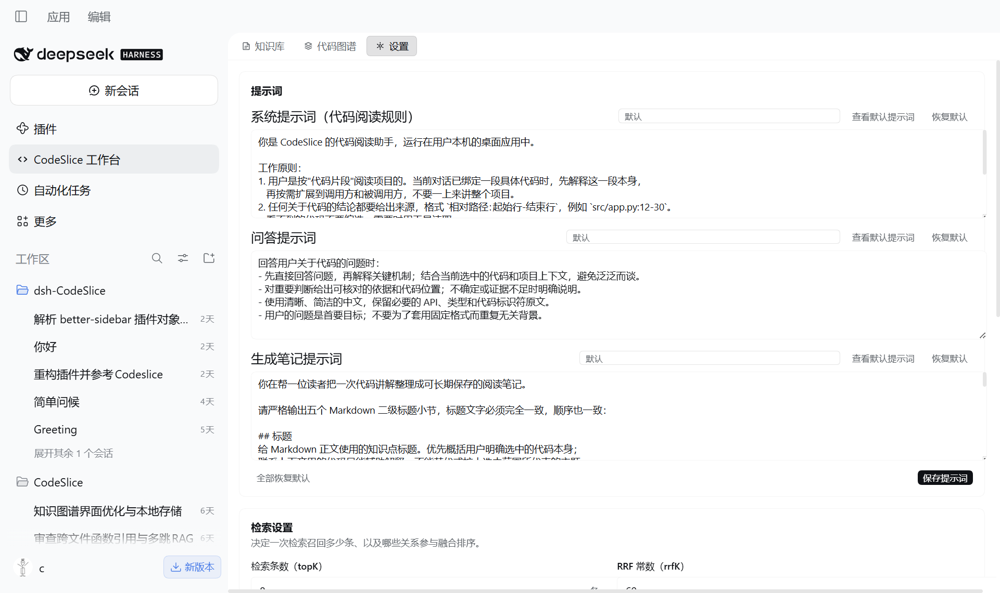

# dsh-codeslice

以**图谱 + 笔记**的方式读代码，和对话同屏。

> DeepSeek Harness 插件。npm 包名 `dsh-codeslice`，MIT 许可，零运行时依赖。

---

## 0. 安装

先装进你的 DSH profile（与其它插件同一种方式）：

```bash
# 在 ~/.dsh/profiles/<profile> 下，用该 profile 的包管理器
npm install dsh-codeslice      # 或 pnpm add dsh-codeslice
```

然后在同一个 profile 的 `package.json` 里把它加入 bundle 列表：

```json
{
  "dsh": {
    "profile": {
      "bundles": ["@deepseek-ai/dsh-base", "@deepseek-ai/dsh-web-app", "dsh-codeslice"]
    }
  }
}
```

重启 DSH。Host 半只在启动时加载；Client 半在页面刷新后生效。

本地开发时也可以直接 `link:` 到本仓库的 `plugin/`，改完执行
`cd plugin && node dev/build-client.mjs`，然后重启 DSH / 硬刷新页面。

---

## 0.1 界面预览

### 知识库：文件夹在前，未分类在后



右侧栏的知识库标签。顶部一行是搜索与刷新，第二行是**带文字**的操作：
新建笔记、新建文件夹、导入、导出、全部导出。下面是一棵树：知识库根节点 →
文件夹（可逐层展开）→ 文件夹里的笔记，最后才是「未分类」。缩进与左侧引导线
表示层级；文件夹名称与计数在同一行，悬停才出现重命名/删除。文件夹和笔记共用
30px 行高、12px 字号：文件夹用主色 + 半粗，笔记只用常规字重显示标题，不再有
摘要和时间把行撑高。


树结构特写：`知识库 → 目录 / 图谱设计`，折叠箭头只负责展开，点击文件夹名
只选中并展开该层，不会把整棵树压平成搜索结果。

### 笔记阅读：单栏，不与列表抢宽度



打开笔记后列表让位给阅读器，而不是在窄栏里硬塞两列。阅读器顶部有返回、
移动到文件夹、编辑、导出；正文按 Markdown 渲染，代码引用显示为可点击的
`路径:行号`，锚点状态显示为「有效 / 漂移 / 缺失」。

### 工作台：笔记、项目、设置三页



左侧导航进入 CodeSlice 工作台。笔记页同样是树 + 阅读器：左边选文件夹和笔记，
右边阅读全文；项目页登记工作区与图谱统计；设置页管理提示词和检索。


工作台的笔记树与右栏共用同一套排序：文件夹在上、未分类在下，搜索结果也保留
文件夹层级，而不是丢到一张平表里。

### 设置：提示词与检索



系统提示词（代码阅读规则）、问答提示词、生成笔记提示词都可单独查看默认值、
保存自定义或恢复默认。下面依次是检索条数 / RRF 常数、关系族、笔记与图谱来源、
本地 Ollama 向量模型和向量索引状态。

### 代码图谱


工作台的「代码图谱」页先列出已登记项目及其规模（文件、行、节点、边、社区），
点「打开图谱」进入 vis-network 画布。节点按度数缩放、按社区着色；顶部可按
调用 / 依赖 / 结构等关系族过滤，右侧可缩放、适配和打开详情。

---

这是在 `D:\CodeSplit`（产品名 CodeSlice 0.2.2）审定之后，为 DeepSeek Harness 重写的一层实现。
**不 import 原项目、不修改原项目**——移植的是它的算法与交互模型，不是它的进程模型。原项目里的
终端执行、命令审批、会话管理、设置面板、桌面壳全部交还给宿主（那是 DSH 已经做得更好、而且
在宿主里重做一遍等于开一条绕过沙箱旁路的部分）。

- 设计取舍与缺陷清单：[`../../DESIGN.md`](../../DESIGN.md)
- 端口规格（算法）：[`../../spec/backend-methods.md`](../../spec/backend-methods.md)
- 端口规格（交互）：[`../../spec/frontend-interaction.md`](../../spec/frontend-interaction.md)
- 两端接口契约：[`WIRE.md`](WIRE.md)

---

## 1. 它补的是 DSH 没有的四件套

| 能力 | 说明 | 桌面版对应 |
|---|---|---|
| **AST 知识图谱** | 节点是文件/类/函数/说明；边是调用、导入、继承、包含、方法、说明。两趟解析，跨文件绑定调用 | `graph/` |
| **符号导航** | 光标处定义、符号引用、按名字检索，带置信度 | `api/navigation.py` |
| **混合检索** | 中文按重叠二元组分词，英文按单词；关键词覆盖率 + 词频，再与本地 Ollama 向量做 RRF 融合。**这是中文查询和「意思相近但用词不同」都能用的原因** | `retrieval/` + `models/embeddings.py` |
| **固定切分索引** | 结构块（函数/类）优先，其余按桌面端 60 行带切分；向量批量生成并持久化，代码变动只重算变化的块 | `indexing/` |
| **笔记 + 锚点** | 笔记引用代码位置；代码改动后锚点报告 `fresh / moved / drifted / missing` | `services/anchors.py` |

## 2. 给模型的工具（全部只读）

| 工具 | 用途 |
|---|---|
| `codeslice_graph_query` | 把自然语言问题变成一小片高价值子图（按 IDF 打分选种子 → BFS/DFS 扩展 → 文本渲染） |
| `codeslice_graph_node` | 一个符号/文件的全貌：定义、说明、按类分组的进出关系 |
| `codeslice_graph_path` | 两点之间的最短关系路径，按最弱一跳给整体置信度 |
| `codeslice_graph_rationale` | 这个符号被写成这样的**原因**（docstring 与 `NOTE:`/`WHY:`/`注意:` 注释） |
| `codeslice_search` | 按内容检索，不只按名字。中文可用 |
| `codeslice_definition` | 某个文件某一行可见的声明 |
| `codeslice_references` | 到达某个声明的调用点（grep 分不清同名符号，这里分得清） |
| `codeslice_outline` | 一个文件的声明、签名、导入与被导入 |
| `codeslice_notes` | 读者自己的笔记库 |
| `codeslice_index` | 索引健康度与调用解析率——用来判断这张图值不值得信 |

v0.2.0 的旧工具名（`codeslice_symbol` / `codeslice_callers` / `codeslice_inheritance` /
`codeslice_explain` / `codeslice_hot`）保留为别名，指向新管线，所以旧提示词不会失效。

## 3. 给人的界面

| 位置 | 注册方式 | 内容 |
|---|---|---|
| 左侧栏 → 主面板 | `sidebar.panellist` + `main` 槽 | **CodeSlice 工作台**：代码 / 图谱 / 笔记 / 检索设置 |
| 右侧栏 / 底部工作台 | `betterSidebar.registerTab` `codeslice:graph` | vis-network 力导向图谱 + 检查器（关系分组、社区列表、图内搜索、族过滤） |
| 同上 | `codeslice:notes` | 笔记树 + 阅读器 + 锚点漂移状态 |
| 同上 | `codeslice:outline` | 文件大纲（按路径去重） |
| 文件查看器 | `registerFileViewer` `codeslice:annotated` | 带批注的只读视图（`fsRead`，优先级 −200） |
| 输入框上方 | `conversation.input.dock` `codeslice:bar` | 当前选区提示条 + 「生成笔记」 |

`betterSidebar` 不存在时自动降级到 `sidebar.panellist` 独立面板，插件不会因为缺服务而激活失败。

### 工作台的对话就是 DSH 的正常对话

不再有插件自带的第二个聊天框。照桌面版 `App.tsx` / `ChatPane.tsx` 的模型：

- 左侧导航新增「CodeSlice 工作台」：文件列表 → 代码查看/选中 → 图谱/笔记/检索设置；
- 正常对话的输入框上方有一条 CodeSlice 引用条：显示当前选中的 `path:start-end`，并提供「生成笔记」；
- 代码区选中一段 → 「就这段提问」：切回正常对话，通过宿主的 `inputActions.insertQuote` 把代码引用和问题写进**同一个输入框**；
- 图谱检查器里的「就此提问」把节点问题送进**同一个**输入框（`requestPrompt`），不再有独立对话框；
- 每条提问都可以自带当前选中范围（`WIRE-CHAT.md §13`），所以同一个线程里换一段代码追问，不必重开对话；
- 「生成笔记」在 Host 侧通过 `ctx.sessionQuery.readSurface(sessionId)` 读取当前 DSH 会话，按桌面端模板沉淀到知识库；笔记标签里可读、可查锚点漂移。

图谱默认仍是内置分析器；把行配置里的 `graphBackend` 设为 `auto`（或 `graphify`）后，Host 会调用本机
`graphify` 做 AST 抽取与社区聚类，失败自动回退。检索设置里的「本地向量模型 / Ollama」检测 `127.0.0.1:11434`，
只允许回环地址；系统提示词会附加在内置规则之后。

### 交互要点（照桌面版移植，不是自创）

- **画布就是 graphify 的画布**：直接复用 graphify 的 vis-network 参数（forceAtlas2Based
  −60/0.005/120/0.08/0.4/0.8，200 次稳定化），节点按度数大小、高连接节点显示名称，
  连续圆角边 + 箭头；物理稳定后关闭，坐标缓存，切标签不重新抖动。
- **族过滤**：按关系族（调用 / 依赖 / 结构 / 继承 / 说明）过滤；推断出来的边画虚线且更细。
  `inherits` 默认可达——桌面版这里有个「继承了却过滤不出来」的 bug，没复现。
- **图内搜索**：输入即时过滤，`↑`/`↓` 移动，`Enter` 选中并居中，`Esc` 清空。
- **全量图谱**：工作区视图最多 5000 个节点；超过时按社区聚合成社区节点（graphify 自己的
  降级方式），而不是砍掉尾部。
- **社区名照桌面端**：成员最多的文件名 + `+N`，孤立节点归入「未分类」，重名用代表符号消歧。
- **切走即停**：`visible === false` 时销毁 vis 实例并记住坐标、中止在途请求、断开 ResizeObserver。
  右侧栏切走的标签页是 `display:none` 但仍然挂载，不做这件事就是在后台烧电。
- **窄变宽变**：量元素宽度（< ~520px 时检查器移到画布下方），不看视口。
- **不轮询**：只在挂载、手动刷新、范围切换、`visible` 变 true 时取数。

键盘：`/` 聚焦搜索、`Esc` 退一层、`f` 适配画布、`+`/`-` 缩放。输入框有焦点时不抢键。

代码窗用 CodeMirror 6（与右侧栏编辑器同栈），**懒加载**：只在第一次打开文件时从
`/codeslice/assets/editor.js` 取。语法高亮、行号、拖选，以及桌面版的「点行号选起点/终点」都保留；
符号行、批注、笔记、当前选区、定位闪烁都画成行装饰。

除图谱画布必须使用 graphify 的 Tableau-10 十六进制色（canvas 解析不了 CSS 变量）外，
界面颜色仍走 `--dsw-alias-*` 令牌。

## 4. 怎么跑 / 怎么验

```bash
cd D:/dsh-CodeSlice/plugin

# 语法
for f in index.js lib/*.js client.js; do node --check $f || exit 1; done

# 客户端源码 → 单文件 bundle（DSH 的模块加载器只认一个 __ModuleLoader__.load 调用）
node dev/build-client.mjs            # 重新生成 client.js
node dev/build-client.mjs --check    # CI：committed 的 client.js 是否已过期

# CodeMirror 懒加载块（需要 esbuild + @codemirror/*；产物 client/editor.js 已提交）
node dev/build-editor.mjs            # 重新生成 client/editor.js（~1.7MB）
node dev/build-editor.mjs --check    # CI：committed 的 editor.js 是否已过期

# Host 半：真索引 + 全部工具 + 全部路由（不需要 DSH）
node dev/host-test.mjs "D:/CodeSplit"          # 79 项
node dev/host-test.mjs "D:/dsh-CodeSlice"      # 79 项
node dev/audit-checks.mjs                      # 30 项：契约/词汇/渲染逐字节/语言闸门/安全面
node dev/cache-probe.mjs                       # 18 项：Map 边界（构建→落盘→加载→还能查）
node dev/robustness.mjs                        # 22 项：空项目/坏输入/路径穿越/无网络无 eval
node dev/workflow-probe.mjs                    # 19 项：笔记→锚点漂移→文件夹→导出→批注
node dev/chat-probe.mjs                        # 241 项：会话存储/四段上下文/RAG/成笔记/SSE/逐轮选区
node dev/rag-split-probe.mjs                   # 13 项：切分固定为桌面端参数，不可自定义
node dev/rag-index-probe.mjs                   # 28 项：批量向量/失败隔离/背景建索引/增量/向量检索/融合/坏文件降级

# Client 半：jsdom 挂真实 bundle，fetch 直连真实 Host 路由
cd dev/harness && node run.mjs "D:/dsh-CodeSlice"          # 420x760 纵向
cd dev/harness && node run.mjs "D:/dsh-CodeSlice" --wide   # 1180x340 横向
cd dev/harness && node audit-fixes.mjs                      # 7 项：深链/请求次数/族过滤/清搜索
node dev/graphify-probe.mjs                                # graphify 可选图源（未安装则跳过）
```

`dev/harness/node_modules`（react / react-dom / jsdom）只为验证，不参与发布——
`package.json.files` 不含 `dev/`，插件本身零运行时依赖。

## 5. 生效方式

- **Host 半**（`index.js` / `lib/*`）→ 重启 DSH（Node 侧不热更）
- **Client 半**（`client/src/*` 改完先 `node dev/build-client.mjs`）→ 浏览器硬刷新
- **懒加载块**（`client/vendor/vis-network.min.js`、`client/editor.js`）→ 改完需同步重建并刷新；
  两项都通过 `/codeslice/assets/*` 提供，离线可用
- 索引缓存：`%TEMP%\dsh-codeslice\<sha1(root)>.index.json`，删掉即强制重建，
  或调用 `POST /codeslice/api/rebuild`
- 向量索引：`<rootKey>.vectors.json`（manifest）+ `<rootKey>.vectors-<nonce>.bin`
  （Float32 打包）。设置页「构建索引」在后台增量生成；模型变更后需「强制重建」。
- 笔记库：`%TEMP%\dsh-codeslice\<sha1(root)>.notes.json`——**这是用户数据，别当缓存删**

## 6. 与桌面版的已知差异（都是刻意的）

| 差异 | 原因 |
|---|---|
| 向量索引由本地 Ollama 生成，不在插件里内嵌模型 | 插件只做回环 HTTP（`models.js`），不捆绑运行时；没有 Ollama 时自动退回关键词检索，问题仍然能答 |
| 切分参数固定，不开放自定义 | 切分是索引身份：同一份代码必须切成同一批块，引用与分数才可比。参数照抄桌面端 `chunker.py`（60/220/8000） |
| Louvain 自实现且用 LCG 定序 | 不能带 networkx。社区 label 规则、单例合并、排序照抄；社区 id 可能与 Python 构建不同 |
| **JS/TS 的 `extends` 能解析了** | 桌面版 `superclass_field=None` 是个 bug，导致整个 JS/TS 继承体系在图里不存在。这是本插件要补的洞，不是要复制的问题。`superclassJs: false` 可恢复与桌面版逐字节一致 |
| 代码窗是只读的 CodeMirror | 插件不写用户源码：保存、dirty、git gutter 归宿主/`better-sidebar`；这里只保留阅读、行段选择、批注与提问 |
| 笔记库独立，不与桌面版共享 | SQLite 单写者，共享只会换来锁冲突 |

## 7. 已知限制

- 扫描器是零依赖正则 + 掩码，不是 tree-sitter：类型流转、泛型实例化、宏展开都看不到。
  换来的是「插件不依赖任何运行时包」。
- 解析器宁缺毋错：跨文件调用只按「同文件 → 导入绑定 → 全仓库唯一」三级绑定，歧义一律不连。
  所以 `calls_dropped` 不为零是设计，不是故障；看 `calls_extracted / calls_project` 才是解析率。
- 无 tree-sitter：切分走「正则扫描出的声明 → 结构块；否则行带」，所以一行里塞多个符号、宏展开后的
  结构看不到。换来的是「插件不依赖任何运行时包」。
- 笔记是独立的上下文阶段（按锚点重叠/正文命中），没有进入向量索引；桌面版把笔记也当 chunk，
  这里刻意保留两套排序，避免一条笔记压过用户刚选中的代码。
